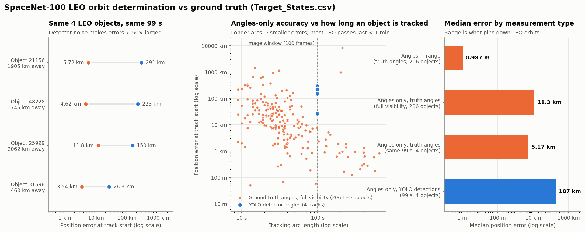

# LEO orbit determination on SpaceDet (SpaceNet-100)

Orbit determination (OD) for low-Earth-orbit resident space objects (RSOs) observed by the SpaceDet
space-based camera, evaluated against the dataset's ground truth (`Target_States.csv`).

The pipeline turns camera measurements (bearing angles, optionally range) into J2000 orbits. It
has three stages: initial orbit determination (IOD), then batch least-squares refinement with a
two-body + J2 force model, then a comparison with the true states. It runs on the dataset's
measurements (`Tracking_Data.csv`) and on detections from the repository's YOLO + BoT-SORT tracker.



## Results (SpaceNet-100, LEO = SMA ≤ 8413 km, median of converged fits)

| | Angles + range (truth) | Angles only (truth angles) | Angles only (YOLO detections) |
|---|---|---|---|
| Objects | 206 | 197 of 206 | 4 |
| Position error | 1.0 m | 9.8 km | 187 km |
| Velocity error | 0.05 m/s | 90 m/s | 80 m/s |
| Range RMS error over arc | 2.9 m | 9.7 km | 183 km |
| Angle RMS error over arc | 0.10″ | 0.10″ | ~1.1″ |
| a / e error | 0.05 km / 5e-6 | 176 km / 0.018 | 128 km / 0.0017 |
| i / RAAN error | 0.0001° / 0.0001° | 0.06° / 0.11° | 0.94° / 0.42° |
| Argument of latitude error | 0.00002° | 0.04° | 0.07° |

- **With range, the orbit is solved to about 1 m.**
- **With angles only, the errors come from range (depth).** The fitted orbits reproduce the
  angles to 0.1″, but the distance to the object is poorly determined over short arcs. The error
  falls from tens of km for passes under 30 s to under 1 km beyond 2–3 minutes. Most LEO passes
  last under a minute.
- **YOLO detections:** the box centres are accurate to a median 0.35 px (1 px = 18.9″), about
  15″ RMS per axis. The images cover only 100 s, so every track is at most 99 s long. Over the same
  99 s, detector noise makes the errors 7–50 times larger than with truth angles.
- **AOP and TA** are poorly defined for these near-circular orbits. Their sum (argument of
  latitude) is the meaningful quantity.

Per-object values (estimated vs true Angle1, Angle2, Range and the six elements, with errors) are
in `results/orbit_determination/final_leo_od_results_rsw.csv`. Statistics are in
`final_leo_od_summary_rsw.csv`.

## Measurement model (derived from the data, verified to 0.12″ / 2.9 m)

- **Line of sight in the camera frame:** `u = normalize(tan(Angle2), tan(Angle1), 1)`. `Range` is
  the distance from the observer to the target in km.
- **Camera attitude:** fixed in the observer's RSW frame, `C_cam→RSW = Rx(−15°)·Ry(15°)`
  (`elevation_deg=15`, `azimuth_deg=90` in the code).
  - `Metadata.csv`'s quaternion (scalar first, rotating GCRS into the body frame; camera = body
    turned 180° about the boresight) gives the same attitude, but with about 36″ of simulated
    attitude-knowledge noise per epoch. Select it with `--attitude quaternion`.
- **Frames:** the `Position`/`Velocity` columns are ITRS, and the `*-J2000` columns are GCRS as
  computed by astropy (they agree to < 1 mm).
  - `Target_States.csv`'s `SMA…TA` columns are in an *of-date* equatorial frame. i, RAAN and AOP
    differ from J2000 by up to 0.45° because of precession, so the true elements are recomputed
    in J2000 for the comparison.
- **Observer:** `Metadata.csv`'s WGS84 latitude/longitude/altitude, converted to GCRS. These
  positions carry metre-level, GPS-like noise, so the ephemeris is a J2 orbit fit plus a heavily
  smoothed residual spline. It reproduces all ranges to 2.9 m RMS (the 0.01 km rounding floor) and
  uses no target information.
- **Image boxes:** each label box spans the object's motion from t to t+1 s, padded by −2 px on
  the minimum side. The detection box centre + 1 px therefore gives the angles at **t + 0.5 s**.
- **Dynamics:** two-body + J2 reproduces the true trajectories to 5–25 m over 10 minutes.
- **TLEs** (`2023-01-01.txt`) reproduce the ground truth to about 10 m, so they are not used in OD,
  to avoid leaking the answer. The observer satellite is not in the catalogue.

## Files

| File | Purpose |
|---|---|
| `dynamics.py` | Two-body + J2 propagator, vectorised Kepler solver, state → classical elements |
| `observations.py` | Data loading, measurement model, observer ephemeris, camera attitude |
| `iod.py` | Gauss (angles-only), admissible-region grid search, Gibbs / Herrick-Gibbs (with range) |
| `batch_ls.py` | Weighted batch least squares (robust loss) with covariance |
| `run_od.py` | OD on `Tracking_Data.csv` for all LEO objects (optionally with added noise) |
| `detect_track.py` | Runs the repository's YOLO detector + BoT-SORT tracker; saves class and pixel boxes |
| `od_from_tracks.py` | Angles-only OD on LEO tracks from `detect_track.py`, plus a truth-angle baseline |
| `final_report.py` | Final per-object comparison (angles, range, 6 elements) and summary statistics |
| `plot_comparison.py` | Comparison figure |

## Usage

Run from the repository root. Put the SpaceNet-100 download (all 100 images, labels,
`Metadata.csv`, `2023-01-01.txt`) under `data/SpaceNet-100/`.

```bash
pip install numpy scipy pandas matplotlib astropy

# 1. OD on the dataset's measurements (ground-truth angles / range)
python codes/orbit_determination/run_od.py --mode angles-range
python codes/orbit_determination/run_od.py --mode angles
python codes/orbit_determination/run_od.py --mode angles --angle-noise 10   # add 10" noise

# 2. YOLO detection + tracking on the 100 images (~45 min on CPU), then OD on LEO tracks
python codes/orbit_determination/detect_track.py
python codes/orbit_determination/od_from_tracks.py

# 3. Final comparison table and figure
python codes/orbit_determination/final_report.py
python codes/orbit_determination/plot_comparison.py
```

Useful options: `--attitude {rsw,quaternion}` and `--observer {auto,metadata,trilateration}`
(`run_od.py`, `od_from_tracks.py`), plus `--min-obs`, `--workers` and `--max-objects`.

## Notes on the original pipeline code

These are worked around in `detect_track.py` / `od_from_tracks.py`. The original scripts are unchanged.

- `ObjectTracker.track_objects` reads `track[5]` (the confidence score) as the class. The tracker
  output is `[x1, y1, x2, y2, id, score, cls, idx]`, so every track gets class 0.
- `YOLOv8Trainer.tracking` converts the box's top-right corner to angles. For LEO streaks (up to
  ~300 px long) the centre + 1 px at t + 0.5 s is the correct measurement.
- With torch ≥ 2.6 the bundled checkpoint needs `weights_only=False` to load, and `default.yaml`
  requests CUDA device 0. `detect_track.py` handles both and falls back to CPU.
